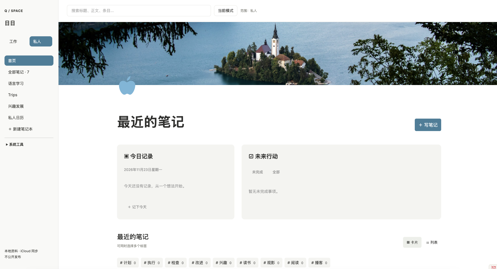

# Qishen Creator Workbench

中文界面名称：自媒体工作台。

An Obsidian workspace for desktop, iPhone and iPad with bundled blank report templates, database views, styles, and optional vault preferences.

## Install

Copy `main.js`, `manifest.json`, and `styles.css` into your vault's `.obsidian/plugins/workspace-preset-kit/` folder. Restart Obsidian and enable **Qishen Creator Workbench** in Community plugins. First test in an empty vault.

In the plugin settings, choose **安装资源** to add missing templates and views. Choose **应用配置** separately to import editor preferences, appearance, template and daily-note paths, hotkeys, graph defaults, and core-plugin switches. Restart Obsidian afterward. Existing resource files are preserved unless you explicitly enable overwrite. Changing the configuration folder uses the vault's configured location for the installer; some inherited workspace features still assume `.obsidian`.

## Included

- A personal workbench with work and personal categories, structured records and report editing.
- 40 blank resources: report templates, template documentation, database views, module configuration and a style snippet.
- Seven optional settings groups, including the bundled module's keyboard shortcuts.
- Journaled import and restore. Restore skips files changed after import.

Global settings affect the entire vault. Configuration changes are opt-in. Installation does not synchronize devices. Install the package on each device and use a separate vault synchronization service for personal content.

## Privacy and external services

The release contains generic source code, blank templates and sanitized preferences. It excludes private notes, business records, original attachments, drafts, backups, workspace history, calendar identifiers, credentials and local account configuration. The plugin has no bundled API keys or signed-in session. Normal editing is local. Optional AI features send the selected context to the provider you configure; optional video metadata retrieval contacts the source platform. Review the context before using these features.

External system-calendar integration has been removed. Calendar entries are local vault records; editing or deleting a previously imported entry does not modify its original system-calendar event. The external script-assistant launcher has been removed; manual script editing remains available. Mobile reports use browser image processing and platform-aware external links. iPad landscape retains a desktop-style sidebar; narrower windows use compact top navigation.

## File access and optional connections

Backups use only Obsidian vault APIs and are written to `工作台备份/` inside the vault. Daily backups are deduplicated; manual backups use separate folders. The backup folder is excluded from its own source set. A completion marker is written only after all copies succeed. Existing external backups are left untouched. Vault-local backups share the vault storage and synchronization fate, so keep a separate external backup for recovery from total vault loss.

Optional AI writing uses DeepSeek, Alibaba Cloud Qwen, OpenAI, or the compatible API endpoint you configure. These services may require an account and paid API usage. Video metadata lookup uses YouTube or Bilibili. Opening selected external links contacts their destination; downloading a referenced PDF or image contacts its source. These actions depend on the relevant network service and are not required to install the blank templates.

## Recovery

Use **恢复上次导入** to restore the last import. Recovery journals remain inside the plugin's `profile-backups` folder and may contain your pre-import settings: they are local runtime data and must never be included in a public release. Removing the plugin does not remove installed templates or settings. Use restore before uninstalling when needed.

## Verification

JavaScript syntax and bundle loading were checked. In-memory adapter tests cover preserving existing templates, settings merge, restore, repeated installation, edited-file protection, explicit overwrite and rollback after a simulated write failure. A real Obsidian UI installation has not yet been tested.

## Screenshots / 界面预览

### 首页与模块导航

### 私人主页与标签笔记

Screenshots show an existing configured workspace. Displayed records are not bundled with the plugin.

## 2.6.4

Removed native calendar bridge and process execution. Backups now stay inside the vault. No Node.js filesystem access remains in the release. The plugin still scans vault records and may show other review recommendations.

## 2.6.5

Opening the cooperation archive in a fresh vault initializes an empty HTML archive and linked record from the bundled template. Existing archives are preserved. The archive location follows the current workspace root.

## 2.6.6

- Phone: horizontal top navigation, two-column cards, compact filters and action rows.
- iPad landscape: desktop-style sidebar, adaptive cards and split-screen support.
- Native back/forward restores filters, search and scroll position, with no added back button.
- All report templates support continuous mobile reading and section anchors.
- Navigation respects the status bar and native Obsidian header and scrolls away in narrow report pages.
- Preserves cooperation archive initialization, vault-local backups and resource recovery.

Verified with simulated phone/tablet viewports and native Obsidian history methods. Physical-device behavior may vary with the installed theme and Obsidian version.

## 2.7.0 — Work and personal notes

- Unified work/personal navigation, editable notebook names, ordering and new notebooks.
- Personal homepage with today's notes, future actions, tag filters and card/list views.
- All Notes summary with statistics, search, notebook/tag filters and right-click organization: rename, move, tag, delete and restore.
- Autosaved block editor with `/` and `//` insertion, selection formatting, text colors and highlights. New empty drafts are discarded on exit.
- Paper White / Mist Blue palette; typography, spacing, cards and editing geometry stay fixed across palettes.
- Replaceable work/personal covers, editable page titles and customizable icons.
- Travel journals use an eight-section template; recent trips include related notes and reports.
- API conversation, writing, optional web search/weather and save-as-note tools. External desktop-agent applications remain separate.
- Preserves opt-in profile installation, edited-file protection, vault-local backups, archive initialization and native navigation history.

The two previews above show the updated local workspace supplied by the author. Private titles have been obscured in the work preview; personal records are not included in the release. Cold-start color flashing remains under investigation. Physical iPhone/iPad testing is pending.
