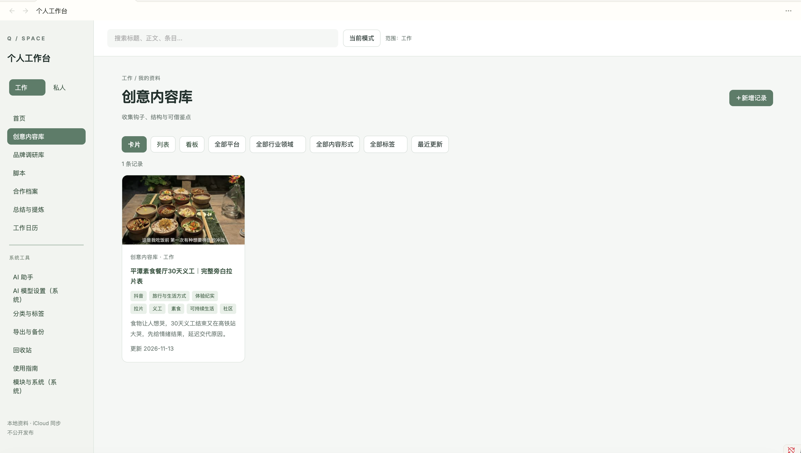

# Creator Workbench

中文界面名称：自媒体工作台。

A desktop Obsidian workspace with bundled blank report templates, database views, styles, and optional vault preferences.

## Install

Copy `main.js`, `manifest.json`, and `styles.css` into your vault's `.obsidian/plugins/workspace-preset-kit/` folder. Restart Obsidian and enable **Creator Workbench** in Community plugins. First test in an empty vault.

In the plugin settings, choose **安装资源** to add missing templates and views. Choose **应用配置** separately to import editor preferences, appearance, template and daily-note paths, hotkeys, graph defaults, and core-plugin switches. Restart Obsidian afterward. Existing resource files are preserved unless you explicitly enable overwrite. Changing the configuration folder uses the vault's configured location for the installer; some inherited workspace features still assume `.obsidian`.

## Included

- A personal workbench with work and personal categories, structured records and report editing.
- 38 blank resources: report templates, template documentation, database views, module configuration and a style snippet.
- Seven optional settings groups, including the bundled module's keyboard shortcuts.
- Journaled import and restore. Restore skips files changed after import.

Global settings affect the entire vault. Configuration changes are opt-in. Installation does not synchronize devices. Install the package on each desktop and use a separate vault synchronization service for personal content.

## Privacy and external services

The release contains generic source code, blank templates and sanitized preferences. It excludes private notes, business records, original attachments, drafts, backups, workspace history, calendar identifiers, credentials and local account configuration. The plugin has no bundled API keys or signed-in session. Normal editing is local. Optional AI features send the selected context to the provider you configure; optional video metadata retrieval contacts the source platform. Review the context before using these features.

The existing external Obsidian assistant and macOS calendar helper are not included. Features requiring them are unavailable without separate installation/configuration. This release is desktop-only because inherited code uses Node.js/Electron; mobile compatibility has not been verified. No guarantee of community-directory acceptance is made.

## File access and optional connections

The desktop workbench can create independent backups outside the vault, in `Workspace-Backups` under the operating system user's home directory. This supports recovery if the vault itself is lost. Backups contain the records and attachments in the workspace; they remain local and are not uploaded by the backup operation. Check this directory when migrating or removing your data.

Optional AI writing uses DeepSeek, Alibaba Cloud Qwen, OpenAI, or the compatible API endpoint you configure. These services may require an account and paid API usage. Video metadata lookup uses YouTube or Bilibili. Opening selected external links contacts their destination; downloading a referenced PDF or image contacts its source. These actions depend on the relevant network service and are not required to install the blank templates.

## Recovery

Use **恢复上次导入** to restore the last import. Recovery journals remain inside the plugin's `profile-backups` folder and may contain your pre-import settings: they are local runtime data and must never be included in a public release. Removing the plugin does not remove installed templates or settings. Use restore before uninstalling when needed.

## Verification

JavaScript syntax and bundle loading were checked. In-memory adapter tests cover preserving existing templates, settings merge, restore, repeated installation, edited-file protection, explicit overwrite and rollback after a simulated write failure. A real Obsidian UI installation has not yet been tested.

## Screenshots / 界面预览

### 首页与模块导航

### 创意内容库

Screenshots show an existing configured workspace. Displayed records are not bundled with the plugin.
